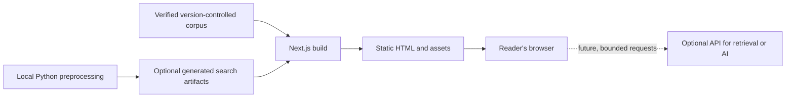

# Mushroom Zi — Architecture Decisions

**Status:** Initial evaluation completed; recommendations are recorded below, but the framework and hosting choices remain open until a small build proves the fit. No model provider or production deployment has been selected. Keep product behavior in [`product-specification.md`](product-specification.md).

## Architecture goals and constraints

- Start with the simplest design that supports the initial public reading experience and a carefully verified corpus.
- Keep clear boundaries between the frontend, source content and metadata, NLP preprocessing, search and retrieval, LLM generation, orchestration, evaluation, and deployment.
- The Python ML pipeline may run locally and produce reusable artifacts (for example, embeddings or search indexes) for a lightweight production application. An always-running Python service is not a requirement.
- Introduce infrastructure only to meet a demonstrated need. Do not add a hosted database before one is needed.
- Preserve a structured path from simple lexical search to evaluated semantic retrieval and grounded generation.

### Hard operating constraints

- Annual operating cost must remain below **$20**, preferably $0.
- No mandatory paid database, always-on paid server, uncapped usage-based billing, or exposed API keys.
- AI requests need strict rate and usage limits, hard cost/model caps, and graceful failure when providers are unavailable.
- Core reading and daily lessons must remain available without AI services.
- Start on a free hosting subdomain; a custom domain is optional.
- A free tier must not be assumed permanent or sufficient for unlimited public traffic. Verify current pricing, limits, and restrictions before recommending a provider or deployment design.

## Initial architecture review — 2026-10-11

### Frontend options

| Option | Fit for Mushroom Zi | Trade-off |
|---|---|---|
| **Next.js with static export** | Build one HTML page for every known book, passage, and language route. Next.js can generate dynamic route segments at build time from a finite list. This puts the passage text in the initial HTML, which supports direct links, sharing, and search discovery. | More framework concepts and build rules. Static export excludes request-time features such as middleware, redirects, cookies, server actions, and default image optimization. New/changed corpus entries require a rebuild and redeploy. |
| **React + Vite SPA** | Vite creates a static bundle that can be deployed to a static host. It is a lean choice when most content is behind one client-rendered app and SEO is less central. | The default build is a bundle rather than HTML generated for every route. Route fallback and pre-rendering for passage pages would need additional setup. Vite supports SSR, but its documented SSR production flow has separate client and server builds plus a server entry. |

**Recommendation:** use Next.js, React, TypeScript, and Tailwind CSS with static export for the first public reader. Passage pages are public, relatively stable, and enumerable from the corpus, so build-time generation fits the product better than a browser-only shell. Use explicit locale paths such as `/en/...` and `/zh/...`; do not depend on request-time language detection or redirects in a static export. Keep interactivity in small client-side components and pre-render the content itself.

This is a recommendation to validate with one passage in both languages. If that route-generation exercise feels like needless framework overhead, React + Vite remains a valid alternative, with a deliberate plan for route-level pre-rendering and direct-link handling.

### Python and backend options

| Option | Best fit | Why it is deferred or selected |
|---|---|---|
| **No production Python server initially** | Static reading, date-based daily passage, and early client-side keyword matching. | **Recommended for v1.** Python can still be used locally for text validation, preprocessing, experiments, and generating reusable search artifacts. There is no need to operate an API while the public features are build-time content or browser-side logic. |
| **FastAPI when a live API is justified** | A focused retrieval or AI API. | Preferred future Python service candidate: type hints drive request parsing, validation, and OpenAPI documentation. A deployed API still needs a running service or serverless runtime, security, restarts, resource limits, and usage controls. |
| **Django if the product becomes database-backed** | Editorial admin, accounts, permissions, forms, and relational data in one application. | Powerful when those built-in features solve a real need. Those capabilities are unnecessary for version-controlled content and no initial accounts, so Django would add framework surface without helping the first release. |

**Recommendation:** start with local Python scripts, not FastAPI or Django. Add a runtime only when a feature cannot reasonably be precomputed or run in the browser. If the first server-side feature is a narrow retrieval/LLM endpoint, evaluate FastAPI; if content editing, accounts, and a relational application become central, compare Django again. Any LLM key must stay server-side, and provider/API usage limits must be enforced outside the browser.

### Content, search, and deployment shape



- Keep the initial corpus in version control, with stable IDs and source/translation provenance. A structured file format is preferable for nested translations, themes, and interpretations; choose JSON or Markdown after shaping a small real sample.
- Generate every published passage and language route at build time. A correction to text or translation triggers a rebuild, which keeps the deployed corpus reviewable and reproducible.
- The daily selection can be computed in the browser from the user's current date and a deterministic passage list. The initial site does not need a database or scheduled job.
- Start with browser-side keyword matching. Later, local Python code can produce tokenized text, TF-IDF tables, embeddings, or vector indexes as build artifacts. Add a live API only if browser-side or build-time retrieval is insufficient.
- A future public LLM endpoint cannot be protected by client-side limits alone. It needs a server-side secret, request and token caps, abuse controls, and a defined failure path. Do not implement it as part of the static-reader milestone.

### Static hosting options checked on 2026-10-11

| Host | Current documented fit | Limits to keep in view |
|---|---|---|
| **Cloudflare Pages** | Recommended candidate for the static proof. Its guide explicitly supports Next.js static export, Git-based rebuilds, preview deployments, and a free `*.pages.dev` subdomain. Cloudflare currently documents static asset requests as free and unlimited. | Free plan documents 500 builds/month, one concurrent build, 20,000 files per site, and 25 MiB maximum per file. Pages Functions invoke Workers usage limits, so keep the initial project static and re-check limits before adding functions. |
| **GitHub Pages** | Good alternative if the repository is public and the project should live entirely alongside its source. GitHub Free includes Pages for public repositories. | Published site limit 1 GB, soft 100 GB/month bandwidth limit, soft 10 builds/hour limit (except a custom Actions build), and 10-minute deployment timeout. GitHub states Pages is not for running an online business or SaaS. |

Both can host static files without a paid application server. For the current feature set, Cloudflare Pages has a more comfortable documented static-traffic allowance, while GitHub Pages reduces the number of separate services if the repository is public. **No provider is permanently approved by this note:** verify plan terms and actual limits again before deployment. The hosting cost review does not cover a future API or model provider.

Cloudflare currently points new full-stack projects toward Workers, while its Pages documentation still provides a specific path for static Next.js exports. Treat Pages here as a static-file host; revisit the runtime platform if Mushroom Zi later needs SSR or server-side AI endpoints.

### Sources for this review

- Next.js, [Static Exports](https://nextjs.org/docs/app/guides/static-exports) and [`generateStaticParams`](https://nextjs.org/docs/app/api-reference/functions/generate-static-params).
- Vite, [Building for Production](https://vite.dev/guide/build), [Static Deployment](https://vite.dev/guide/static-deploy), and [SSR](https://vite.dev/guide/ssr).
- FastAPI, [Python type hints](https://fastapi.tiangolo.com/python-types/) and [deployment concepts](https://fastapi.tiangolo.com/deployment/concepts/).
- Django, [Getting started](https://www.djangoproject.com/start/), [authentication](https://docs.djangoproject.com/en/6.0/topics/auth/), and [admin site](https://docs.djangoproject.com/en/6.0/ref/contrib/admin/).
- Cloudflare, [Next.js static export guide](https://developers.cloudflare.com/pages/framework-guides/nextjs/deploy-a-static-nextjs-site/), [Pages overview](https://developers.cloudflare.com/pages/), [Pages function pricing](https://developers.cloudflare.com/pages/functions/pricing/), and [Pages limits](https://developers.cloudflare.com/pages/platform/limits/).
- GitHub, [Pages limits](https://docs.github.com/en/pages/getting-started-with-github-pages/github-pages-limits).
- Google Search Central, [JavaScript SEO basics](https://developers.google.com/search/docs/crawling-indexing/javascript/javascript-seo-basics).

The review uses framework and provider documentation available on the date above. These limits can change; repeat the pricing/terms check before launch.

### Risks and decisions still open

| Topic | Risk or unresolved choice | Suggested timing |
|---|---|---|
| Translation rights | A translation that is easy to find is not automatically licensed for republication. Record the rights and source for each translation before publishing it. | While curating the first passages. |
| Daily passage boundary | “Today” could mean the reader's local date or UTC. A browser-side selector is simple, but the expected date boundary should be explicit and tested around midnight and leap days. | Before implementing the daily passage. |
| Bilingual URLs | Decide stable locale paths and language-switch behavior. Static export favors explicit `/en/` and `/zh/` pages over request-time locale redirects. | Before passage routes and SEO metadata. |
| Search artifacts | Token tables and especially embeddings can make downloads larger. Keep source text separate from derived search data and measure asset size before shipping a larger model/index. | As search advances beyond keyword matching. |
| Public AI endpoint | Browser code cannot keep provider keys secret or enforce a trustworthy per-user cost cap. A future endpoint needs a separate runtime, abuse controls, and a verified budget. | Before any LLM integration. |

### Proposed Phase 1 sequence

1. Draft and review the content record shape using one properly sourced passage.
2. Select a stable passage-ID convention and record a small verified corpus with translation rights/provenance.
3. Create the frontend project and generate one direct passage route in both English and Chinese as static HTML.
4. Add book/passage navigation and the deterministic daily selector.
5. Review responsive layout, keyboard access, reduced motion, and the initial SEO metadata before expanding the corpus.

Keep the first code exercise at step 1. It teaches data modeling and provenance before framework setup locks in a data shape.

## Candidate direction

These are starting hypotheses from the brief and the review above, not final decisions:

- **Frontend:** Current recommendation is Next.js, React, TypeScript, and Tailwind CSS with static export. Keep React + Vite as the simpler alternative if the static route proof shows Next.js adds unnecessary overhead.
- **Backend and ML:** Python is preferred for the NLP and ML ecosystem. Use local preprocessing first; compare FastAPI and Django only when a runtime backend is justified.
- **Content and storage:** version-controlled JSON or Markdown for passage content; SQLite for local experiments; FAISS for local vector retrieval; PostgreSQL with pgvector or Supabase only if a demonstrated persistent or hosted database need appears.
- **Learning libraries:** introduce NumPy and scikit-learn, then suitable Chinese tokenization tools, Sentence Transformers, FAISS, PyTorch, and Hugging Face Transformers as the user's understanding and project needs justify them.
- **LLM integration:** evaluate affordable providers with secure usage controls only when the product reaches that milestone. Avoid heavyweight orchestration frameworks until a concrete problem warrants one.

## Proposed evolution of search

Build and evaluate progressively rather than assuming a more complex method is better:

1. Keyword matching.
2. Chinese text normalization and tokenization.
3. TF-IDF and cosine similarity.
4. Multilingual sentence embeddings and semantic search.
5. Vector similarity search and hybrid retrieval.
6. Reranking and relevance evaluation.
7. Retrieval-Augmented Generation (RAG), with passage citations and response evaluation.

One research question is whether adding modern Chinese explanations, English descriptions, and thematic metadata to classical Chinese passages improves retrieval. Compare approaches with an evaluation set rather than relying on intuition alone.

## Initial content model requirements

The corpus model should support at least:

- Stable passage identifiers independent of displayed language or text revisions.
- Book and passage ordering, original classical Chinese text, and optional text variants such as simplified/traditional Chinese and pinyin.
- Multiple translations with language, translator or source attribution, license/provenance, and edition or citation details.
- Multiple interpretations and commentary entries, each attributed and classified (for example, scholarly interpretation versus project-authored modern application).
- Themes and concepts linked in a way that supports thematic browsing and later retrieval experiments.
- A clear distinction between primary source material, translations, interpretations, and generated content.

The concrete JSON/Markdown schema remains an implementation design task; fields and identifiers should be reviewed against the first verified passages before the schema is treated as stable.

### Conceptual record shape

The following is a field-level design sketch, not a committed file format or validated schema:

```text
Passage
  id                  stable canonical ID (independent of wording and language)
  book                book number and display name
  sequence            order within the book
  source_text         classical Chinese text and source reference
  text_variants       optional simplified/traditional forms and pinyin
  translations[]      language, text, translator, edition/source, license, citation
  interpretations[]   kind, language, text, author/source, citation, provenance
  themes[]            stable concept IDs and display labels
```

Translations and interpretations are collections because a passage may have more than one. Each commentary item needs a type that makes scholarly interpretation distinguishable from project-authored explanation, modern application, or generated output. The canonical passage ID should survive edits to a translation or display label; avoid deriving identity solely from text, which may be corrected or normalized later.

## NLP and multilingual text considerations

- Classical Chinese generally does not provide modern word boundaries, and grammatical conventions differ from modern Chinese. A modern Chinese segmenter may not produce appropriate tokens for the source text.
- Modern Chinese explanations can supply useful vocabulary and context, but must remain distinct from classical source text so experiments can measure whether adding them helps retrieval.
- English translations express interpretations and may use different wording or segmentation for the same passage. Treat language and text type as explicit metadata in retrieval experiments.
- Preserve the authoritative source strings as entered and verified. Produce normalized/tokenized search representations as derived data with a documented preprocessing version; normalization should not silently replace source text or erase meaningful variants.
- Build evaluation queries in both languages and across text types. Track whether a result is relevant to the query and whether the cited passage actually supports the generated response.

Topics to learn in sequence include Unicode and normalization, Chinese tokenization and word segmentation, classical-versus-modern Chinese NLP, bag-of-words, TF-IDF, cosine similarity, vector-space models, information retrieval, precision/recall/ranking metrics, embeddings, transformer and attention basics, multilingual semantic similarity, vector search, hybrid retrieval, reranking, RAG, prompt/context construction, structured outputs, grounding, hallucination reduction, evaluation, token usage, latency, and inference cost. Later experiments may cover PyTorch, training loops, loss and optimization, fine-tuning and parameter-efficient adaptation, learning-to-rank, recommendations, tool calling, agent orchestration, state/memory, and personalization. Introduce each after its prerequisites and when it serves a real project question.

## Repository organization proposal

Keep user-facing requirements and architectural learning records distinct from application code. A possible structure as the project grows:

```text
AGENTS.md
docs/
  product-specification.md
  architecture-decisions.md
  learning-roadmap.md        # add when milestone tracking needs more room
content/                     # version-controlled source corpus and metadata
web/                          # frontend application
ml/                           # Python preprocessing, experiments, and evaluation
```

This is a proposal, not a required layout. Keep the first implementation small and introduce directories when they have actual contents.

## Decision log

| ID | Topic | Status | Current position | Revisit when |
|---|---|---|---|---|
| A-001 | Initial content source | Proposed | Keep verified content in version control; choose JSON or Markdown after designing the first passage records. | The first corpus sample is modeled. |
| A-002 | Frontend framework | Recommended | Next.js + React + TypeScript + Tailwind with static export; validate a bilingual passage route. Vite remains an option if static route generation is too much framework overhead. | The first route/content proof is built. |
| A-003 | Python runtime | Recommended | No production Python server at launch. Use local scripts for preprocessing; evaluate FastAPI for a future narrow API, Django if a database-backed editorial/account product is justified. | A feature requires live server-side processing. |
| A-004 | Database | Deferred | No hosted database for the initial release; use local or version-controlled data until persistence needs are concrete. | User accounts, edits, or dynamic data become necessary. |
| A-005 | Static hosting | Recommended | Cloudflare Pages is the current static-host candidate; GitHub Pages is an alternative for a public repository. Recheck price, plan terms, and limits before deploy. | Before first public deployment. |
| A-006 | AI/model provider | Deferred | No provider selected. Verify current price, rate/cost caps, key handling, privacy terms, and failure behavior when AI integration is evaluated. | Grounded LLM integration milestone. |
| A-007 | Initial Analects research reference | Selected for research | Use [A. Charles Muller's Analects page](http://www.acmuller.net/con-dao/analects.html) as the initial working reference. This does not establish permission to republish its translation; record attribution and verify reuse rights before publication. The page could not be fetched during this review, so its license status remains unverified. | Before adding translated text to the public corpus. |

## Learning and delivery sequence

The detailed project roadmap should be updated as milestones are completed. Initial sequence:

1. Compare architecture options and record decisions.
2. Set up the repository and design a provenance-aware content schema.
3. Curate a small verified passage collection.
4. Build the reading experience, navigation, daily passage, and accessibility foundations.
5. Establish the Python learning environment and text preprocessing pipeline.
6. Implement keyword search, tokenization, TF-IDF, cosine similarity, and an evaluation set.
7. Progress to embeddings, multilingual and hybrid retrieval, reranking, and retrieval evaluation.
8. Add grounded LLM features only after retrieval quality, safety, cost, and rate limits are addressed.
9. Evaluate deployment and public release against the hard budget and service constraints.

The longer-term roadmap also includes frontend search integration, passage citations, situational guidance, reflective dialogue, response-quality evaluation, abuse prevention, static optimization, secure API integration, usage limits, monitoring, production checks, PyTorch experiments, custom ranking, fine-tuning experiments, advanced agents, and optional accounts or saved learning progress. These are future possibilities, not commitments for the initial release.
